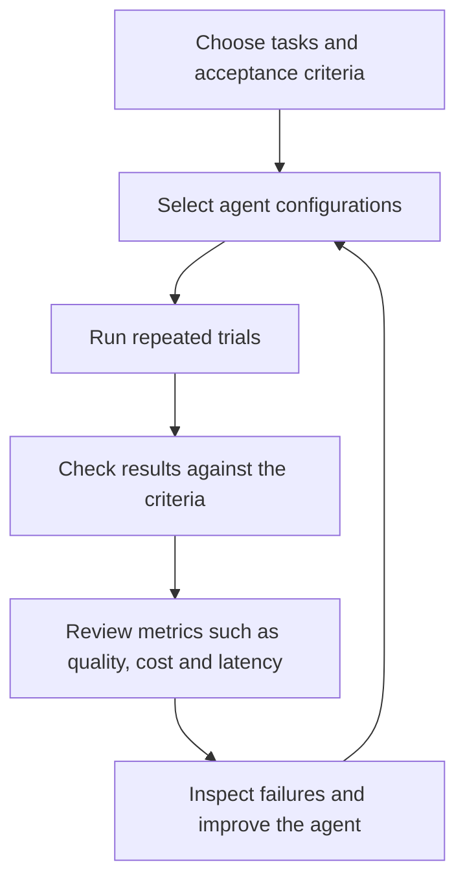
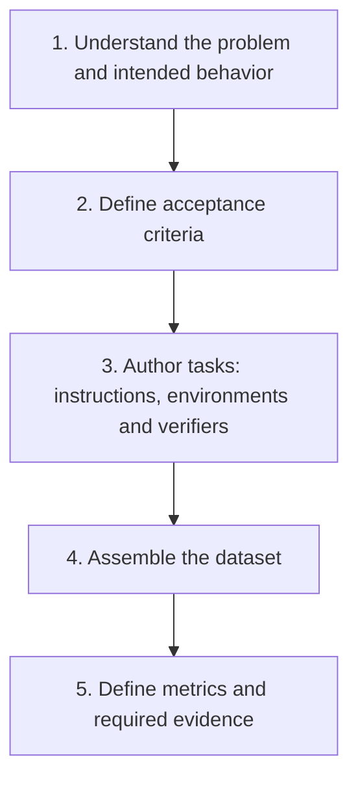
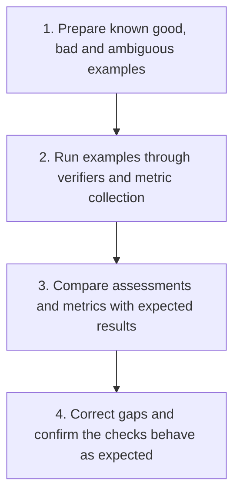

# mo-eval

You build an agent. People use it and report that it misses things, makes mistakes or costs too much. You change the prompt, tools or model. How do you know the agent improved—and that you did not introduce another regression?

Or start with a problem you care about: how well do existing agents solve it, where do they fall short, and what would meaningful progress look like? Define the evaluation, establish a baseline, and measure improvements against it.

mo-eval is a hosted service for evaluating and improving AI agents. Select representative tasks, specify what good behavior means, run configurations under comparable conditions, and inspect quality, cost and latency. Repeat after a change to assess whether it helped. AI can help author tasks and checks; those checks still need validation against known good and bad behavior.

Start with a supported agent and existing tasks, or bring your own agent and tasks. Examples include coding agents, code-review agents, on-call triage agents and anti-piracy investigation agents. They share the same evaluation loop, but each use case has its own specifics, such as its environment, acceptance criteria and relevant metrics.

## Contents

- [Questions you can investigate](#questions-you-can-investigate)
  - [Improving an agent](#improving-an-agent)
  - [Designing the evaluation](#designing-the-evaluation)
- [Getting started](#getting-started)
  - [Connect to the hosted service](#connect-to-the-hosted-service)
    - [Codex](#codex)
    - [Claude Code](#claude-code)
  - [Run your first evaluation](#run-your-first-evaluation)
- [How it works](#how-it-works)
  - [1. Evaluate and improve your agent](#1-evaluate-and-improve-your-agent)
  - [2. Design your evaluation](#2-design-your-evaluation)
  - [3. Validate your evaluation](#3-validate-your-evaluation)
  - [Evaluation components](#evaluation-components)
- [Bring your own tasks and dataset](#bring-your-own-tasks-and-dataset)
  - [Define tasks and collect a dataset](#define-tasks-and-collect-a-dataset)
  - [Author coding tasks](#author-coding-tasks)
- [Bring your own agent](#bring-your-own-agent)
  - [Package the agent and connect its driver](#package-the-agent-and-connect-its-driver)
  - [Validate task and metric compatibility](#validate-task-and-metric-compatibility)
  - [Choose what to customize](#choose-what-to-customize)
- [Understand the results](#understand-the-results)
- [Workflow skills](#workflow-skills)

## Questions you can investigate

### Improving an agent

- Does a change improve the agent on the tasks its users care about?
- Which supported model or agent configuration offers the best quality for the cost?
- Does the agent fail consistently, or vary across repeated trials?
- Why did it miss a requirement, stall, time out or spend unexpectedly?
- Did an improvement on one task introduce regressions elsewhere?

### Designing the evaluation

- How well do existing agents address this problem, and where do they fall short?
- Which tasks represent real user needs and failure modes?
- Do the criteria and verifiers distinguish good, bad and ambiguous behavior?
- Which metrics establish a useful baseline and meaningful progress?
- Does the dataset cover enough variation to support the conclusions you want to draw?

A single passing run does not establish reliability. Reproducible evaluation means retaining the task inputs, effective agent configuration, checks and evidence so the result can be inspected and the condition repeated; an agent’s output may still vary between trials.

## Getting started

### Connect to the hosted service

Use an MCP client that supports HTTP connections and browser-based authentication. The production endpoint is:

```text
https://mcp.evals.gomomento.ai/mcp
```

#### Codex

Run these commands in a terminal:

```bash
codex mcp add mo-eval --url https://mcp.evals.gomomento.ai/mcp
codex mcp login mo-eval
```

For more setup options, see the [official Codex MCP documentation](https://learn.chatgpt.com/docs/extend/mcp?surface=cli).

#### Claude Code

```bash
claude mcp add --transport http -s user mo-eval https://mcp.evals.gomomento.ai/mcp
claude mcp login mo-eval
```

Complete the browser sign-in when prompted. Then ask your assistant:

```text
Check that mo-eval is connected and tell me what I can do with this account.
Do not run an evaluation or upload anything yet.
```

Install the workflow skills from the public [mo-eval repository](https://github.com/momentohq/mo-eval) with your agent. They guide evaluation, task authoring, comparison and analysis; the MCP connection lets the assistant use the hosted service. The assistant checks your access and explains any additional setup needed.

### Run your first evaluation

Ask your assistant:

```text
Use mo-eval-evaluate to help me run a first evaluation. Show me the available
tasks, supported agents and compatible model routes. Propose one small job
and show its trial count and execution limits before submitting it.
```

The assistant discovers available tasks, supported agents and compatible models. Select a task and compatible configuration, review the request, then authorize the job. Execution consumes model tokens and shared compute.

The service returns a job ID. Ask your assistant to follow its progress, stop it if needed, or explain the completed results. It can retrieve the summary, detailed measurements and retained evidence for deeper analysis.

Use `mo-eval-evaluate` to establish a baseline or investigate behavior. Use `mo-eval-compare` to design and interpret a controlled comparison. Hold task inputs and verification fixed while varying the setting you want to evaluate. Several changed settings measure a combined configuration change, not the effect of any one setting. Repeats expose variability; the number and diversity of tasks determine how far the conclusion can generalize.

## How it works

### 1. Evaluate and improve your agent



Each trial retains outputs and execution evidence so you can inspect a failure and understand the reported results.

### 2. Design your evaluation

When existing tasks do not cover your problem, build an evaluation around the behavior your users need. Start with real failures and intended outcomes.



Each task binds its instruction, agent environment and verifier. Tasks can share environment backends or runtime resources while supplying different task data. The dataset collects exact task versions; metrics interpret evidence and assessments over a defined population. Defining metrics may reveal additional evidence requirements or changes needed in the tasks.

### 3. Validate your evaluation

Before using the evaluation to compare agents, validate that it measures the behavior you intended.



Check that verifiers catch the failures you care about, accept valid alternatives and handle uncertainty appropriately. Repeat validation after changes to the evaluation. Observed agent behavior can also expose gaps that need correction. Hold the evaluation fixed when comparing agent configurations so a grading change is not mistaken for an agent improvement.

The evaluation supplies tasks, checks and metrics for the agent-improvement loop above; results from that loop can also inform the next evaluation revision.

### Evaluation components

| Part | What it contributes |
|---|---|
| Agent and configuration | The implementation being evaluated, including its host/harness, model and supported settings |
| Driver | The integration that launches the agent, connects its capabilities and collects outputs |
| Task | The instruction and acceptance criteria, bound to an agent environment and verifier |
| Agent environment | The starting state, available tools/services and interaction rules |
| Dataset | A collection of exact task versions, with grouping and split metadata |
| Evidence | Produced artifacts, logs, captured activity, timing and usage where supported |
| Verifier | Checks the candidate against the task’s acceptance criteria |
| Metrics and report | Summarize assessed behavior, cost, latency and measurement coverage over the planned trials |

You choose the evaluation question and supported inputs. The service handles hosted scheduling, execution and retained results. For coding tasks, the environment is a workspace with a declared runtime and executable verification. Investigation tasks supply queryable records and services, and produce reports or verdicts for assessment. Trace detail varies by integration; an unavailable measurement is not zero.

A job schedules planned trials. Each trial is an intended run of a task under one configuration; an execution retry is another physical attempt of that trial. Regrading retained evidence creates another assessment, not another independent trial.

## Bring your own tasks and dataset

Use the evaluation-design loop to define a new problem or add coverage for observed failures.

### Define tasks and collect a dataset

A task binds its instruction and acceptance criteria to an agent environment and verifier. Reuse existing tasks where their interfaces and acceptance criteria fit. When authoring a different kind of task, supply the domain state/services, output contract and verification needed to assess the agent’s behavior. Select standard metrics or define how additional observations are extracted and aggregated.

### Author coding tasks

Authorized task authors can use the `author-task` workflow to create an unlisted draft from an exact Git snapshot. Supply:

- Repository identity and immutable base commit.
- Instruction and acceptance criteria.
- Test files and an executable verification command.
- A known runtime image and any required setup/dependency preparation.

For task authors, a local helper requires Python 3.11+ and Git to prepare source/test artifacts and a draft request. Task packaging, validation and agent execution run in the hosted service, including checking that the unchanged base fails verification. Publication is a separate authorized action. Read `prepare-repository` for supplied runtime and preparation declarations; automatic runtime inference is not provided.

A base-fails check establishes sensitivity to the initial state, not that every possible fix is correct or that the task is solvable. Review the acceptance criteria and use reference or known-good/known-bad controls where available. A catalog listing establishes availability, not a universal task-quality guarantee.

## Bring your own agent

Consider a code-review agent whose users report missed defects and noisy findings. Its evaluation provides changes and repository context, retains findings, and grades them against reviewed defects and benign controls. Reports show precision, recall, cost and latency across agent versions.

The same structure applies to an on-call agent producing an incident report, or an anti-piracy agent producing an evidence-backed verdict. Their environments supply different facts and tools; their verifiers assess different behavior. A safe, justified uncertainty can be the correct result when the available evidence cannot establish a cause or malicious intent.

### Package the agent and connect its driver

Package the agent’s host, prompts, dependencies and default configuration. Bind it to a driver that launches it, connects the task’s capabilities, enforces lifecycle limits and collects its candidate output and evidence. Reuse a supported driver where possible; provide an adapter when the agent’s launch or interaction contract differs.

### Validate task and metric compatibility

Confirm that the driver can connect the required tools, produce the expected candidate output and capture evidence for the selected metrics. Validate those bindings with a scripted or known-output control before running evaluations. If the existing tasks and criteria fit the agent’s purpose, reuse them; onboarding an agent does not require designing another dataset.

### Choose what to customize

The required customization depends on what you bring:

| What you bring | What may need adapting |
|---|---|
| Supported agent with another compatible model/settings | Configuration |
| New agent for existing tasks | Package, driver and possibly tool/output/trace bindings |
| Additional tasks in an existing dataset | Task data, instructions and reviewed expected behavior |
| New kind of task | Environment behavior, candidate contract, verifier and metric policy |
| Another company’s systems | Service/tool adapters, domain facts, scope and ownership policies |

A new agent needs only a different driver when its capabilities and evidence already match the task contract. New task domains usually require more authoring, but common launch, capture, verification and reporting components should reduce that work.

The service supports reusable drivers and environment integrations, structured checks and calibrated judges, and task-specific metrics. Classification requires reviewed labels, a decision threshold and an abstention policy; diagnosis quality also needs evidence-support and safe-action checks. Custom native log parsing should be reusable across metrics rather than repeated for every report.

Different companies can share execution and measurement machinery while keeping their own tool semantics, runbooks and policies. The onboarding goal is that an additional task mostly adds data and reviewed expectations, rather than another runner or reporting implementation.

## Understand the results

For coding tasks, success depends on executable verification and the service’s trial-result policy. Review successful trials together with measurement coverage and how each execution stopped; a verifier pass alone is insufficient to interpret a trial.

Compare quality across comparable task populations. Report planned and measured counts and separate missing evidence, excluded trials and infrastructure/verifier faults from ordinary failures. Small differences on a few tasks may not support a ranking.

Cost covers work performed even when it does not produce an eligible quality measurement. Check cost completeness before treating a reported amount as a total. Distinguish agent execution time from queue/preparation time. Read available scorer output, artifacts and traces to diagnose a surprising result before changing the agent.

The improvement loop is deliberate: turn a reported failure into a task, establish a check that catches it, change the agent, rerun that task and a representative regression set, then decide whether the evidence supports the change. mo-eval supplies evaluation evidence; it does not automatically repair or deploy your agent.

## Workflow skills

Install the public workflow skills with your agent to guide evaluation and task authoring. Evaluation and comparison are distinct workflows: running a baseline does not require designing a head-to-head experiment.

| Workflow | Purpose |
|---|---|
| `mo-eval-evaluate` | Run and interpret an evaluation, starting with a small baseline |
| `mo-eval-compare` | Design, run and interpret a controlled comparison |
| `author-task` | Create and validate an unlisted coding task draft |
| `prepare-repository` | Declare a known runtime and dependency preparation |

Your assistant can also retrieve the service’s workflow guides directly. Let it discover available tasks, agents and models rather than copying identifiers from an old example. Installed skills guide the workflow; they do not grant service write authority. Skill releases should remain aligned with the served workflows.
