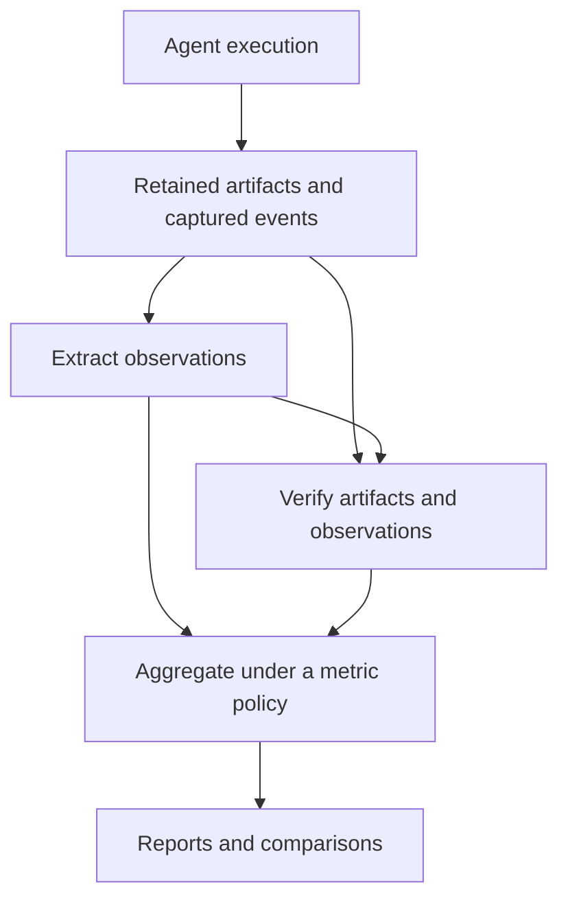

# General purpose agent evaluation service design

mo-eval helps developers improve agents and establish progress on problems they care about. The [product overview](../README.md) explains that experience. This working design describes the component boundaries and integration work needed to make coding, on-call and anti-piracy evaluations use the same service.

Status: collaborative target design, 2026-10-15. This is not an inventory of deployed capabilities or a frozen API. The implementation baseline below distinguishes established coding paths from proposed extensions. Start implementation planning with the [onboarding pilots](onboarding-pilots.md), and attach evidence and tracking issues as work is scoped.

## Contents

- [Vocabulary](#vocabulary)
- [Components and responsibilities](#components-and-responsibilities)
- [Requirements across agent types](#requirements-across-agent-types)
- [Evidence, verification and metrics](#evidence-verification-and-metrics)
- [Defaults and customization](#defaults-and-customization)
- [Service placement and authority](#service-placement-and-authority)
- [Implementation baseline and acceptance evidence](#implementation-baseline-and-acceptance-evidence)
- [Appendix Framework comparisons](#appendix-framework-comparisons)

## Vocabulary

| Term | Meaning |
|---|---|
| Agent | Behavioral implementation, including its host, prompts, tools and configuration |
| Agent package | Retained source/build inputs and dependencies needed to realize an agent |
| Driver | Launches the agent, connects capabilities, manages lifecycle and collects outputs |
| Agent environment | Available state, tools, services and interaction rules |
| World | Domain state and behavior within the agent environment; an explanatory term, not a required separate API resource |
| Execution runtime | Processes, containers or sandboxes hosting an agent, services or verifier |
| Task | Instruction and acceptance criteria bound to exact agent-environment and verifier definitions |
| Dataset | Exact task versions plus grouping, splits, provenance and collection metadata |
| Candidate | Agent-produced output to assess: for example a patch, report or verdict |
| Evidence | Retained candidate, captured activity, execution facts and usage |
| Verifier | Assesses artifacts or observations against criteria, with private oracle inputs where needed |
| Oracle | Reviewed expected facts, acceptable alternatives and uncertainty rules withheld from the agent |
| Assessment | One identified verification result over exact retained evidence |
| Metric policy | Versioned population, assessment selection, aggregation and missingness rules |

A job executes a frozen plan of trials. A trial is an intended sample under one task/configuration condition. A physical retry is another attempt of that trial. Regrading adds an assessment; it does not create another sample or alter execution history.

Use agent environment as the umbrella, world for domain semantics and runtime for hosting. These responsibilities do not automatically need independent public identities. Terminology should help determine what can change independently, not prescribe layers.

## Components and responsibilities

| Component | Contract | Reuse expectation |
|---|---|---|
| Agent driver | Resolve package/configuration; launch; bind tools/model access; cancel; collect candidate and native logs | One integration per launch/interaction contract, not per task |
| Environment backend | Initial state, query meaning, time boundaries, permitted transitions, reset and unsupported-query behavior | Different task data can share a backend |
| Execution runtime | Process/service lifecycle, file transfer, resource/network isolation | Select infrastructure by actual requirements |
| Evidence adapter | Native parsing, common observations, capture provenance and completeness | Parse a format once for multiple consumers |
| Verifier | Criterion results, rationale/evidence references, abstentions and faults | Reuse structured checks; supply domain-specific criteria |
| Metrics and reporting | Declared population and reducers; comparisons, coverage and evidence drill-down | Reuse reporting without assuming pass/fail is the only metric |

A new agent may need only a driver when its tools and evidence already match the tasks. Otherwise add explicit tool/output/capture bindings. A second task should normally add data and reviewed expectations, not another runner.

Compatibility checks need tool schemas and meaning, authority, time behavior, error behavior and capture support. An MCP binding and a typed-service binding may share domain semantics; a shared transport alone does not establish equivalence. Refuse unsupported combinations before execution rather than silently change the task.

Repeated coupling can reveal a missing abstraction: duplicated discovery/credential binding across drivers and backends; domain-specific candidate collection branches in a runner; or every metric parsing every agent log. Introduce a shared contract when concrete integrations demonstrate the need. An incident fixture can correctly own both data and query behavior if they jointly define its observable contract.

## Requirements across agent types

| Component | Coding | On-call triage | Anti-piracy triage |
|---|---|---|---|
| Task input | Requirement and repository snapshot | Supplied incident and trigger time | Supplied entity and time window |
| Environment | Prepared workspace, dependencies, tools | Incident-time tracker, topology/configuration, metrics/logs, runbooks | Traffic/session records, identity, limits and policy |
| Candidate | Patch or declared artifacts | Report and proposed actions | Verdict, evidence and unresolved questions |
| Verification | Behavior and regression tests | Support, resource scope, uncertainty and safe next step | Support, reviewed label/uncertainty and permissible next step |
| Metrics | Success, cost, latency | Supported/safe report rate, completion, report latency | Precision/recall where labels permit, abstention, unnecessary-action rate |

The initial triage tasks are read-only, supplied-clue investigations. Discovery without a starting clue and execution of mitigation are separate task contracts. A syntax-valid proposal is not proof of safe or successful remediation.

Tasks can share environment backends while binding different initial records and clocks. Freeze all behavior-relevant inputs for controlled comparisons; applying a historical query window to today's configuration is insufficient.

## Evidence, verification and metrics

Extraction describes what happened. Verification judges it against the task. Aggregation computes quantities across a population. Verification may execute tests against retained artifacts or consume structured observations; it does not have to grade a text summary.

Retain native logs and versioned parser outputs. Metric-specific derivations can build on common observations without reparsing every native format. Assessments and reports identify the extraction versions they consumed. A corrected parser should be auditable, not silently rewrite old measurements.

Capture tool arguments and served results at a trusted provider/controller boundary when authoritative checks depend on them. Include opening host reads, failures, truncation, time clamps and report/proposal submissions. A candidate-written log can support debugging but does not independently establish tool use or absence of prohibited actions.

Keep verifier faults separate from agent failures. Composite verifiers retain criterion results and the decision rule; mandatory safety checks cannot disappear in an average with style scores. Calibrate human/LLM rubric assessments before treating them as authoritative. Keep judge usage and cost separate from agent usage and cost.

A changed verifier definition creates a revised task obligation. An additional diagnostic assessment may apply that verifier to an older attempt's retained evidence, but it must identify the original task, new verifier and evidence inputs. Reports explicitly select assessments under a metric policy; a later assessment does not silently replace the original task result. Regrading cannot recover observations the original execution never captured.

Every metric declares inputs, version, units, grain, eligible population, weighting, missingness and capture coverage. Report planned and assessable counts, abstentions and faults. Cost includes all work performed, not only successful eligible trials; incomplete usage is unknown rather than zero.

Classification requires reviewed labels and a threshold/abstention policy. Precision is TP/(TP+FP); recall is TP/(TP+FN); false discovery rate is FP/(TP+FP). Report undefined denominators. Repeated trials on one task do not create independent incidents. Preserve task grouping when estimating uncertainty. Avoid a cross-domain scalar without explicit utility weights.

## Defaults and customization

| Service should provide | Integrator supplies |
|---|---|
| Supported process/container launch profiles, budgets and cancellation | Agent package or supported entry point |
| Fixture-serving helpers and trusted capture | Domain records, query semantics and coverage |
| File, JSON, test and rubric checks | Criteria, oracle and exceptional domain checks |
| Classification and operational reducers | Labels, threshold, grouping and weighting |
| Reports, comparisons and trace drill-down | Evaluation question and decision bar |
| Scripted conformance and negative-control templates | Known good, bad and ambiguous outputs |

Configuration should cover common integrations, with code for genuinely new behavior. Users should not implement scheduling, result storage, confusion-matrix arithmetic or viewers. The service cannot invent historical state, company policy or ground truth.

Two companies may share lifecycle, capture and report machinery but use different monitoring systems, scope models and escalation policies. Change the environment/tool bindings and reviewed policy, not the whole evaluator. Similarly shaped tools should remain distinct when their semantics differ.

Measure onboarding effort: inputs and custom code for the first task; additional effort for a second task, another configuration and another company's tool stack. The pilot should record these rather than merely demonstrate that a bespoke integration runs.

## Service placement and authority

The service owns planning, execution authority, enforced budgets/cancellation and retained evidence. The agent driver launches only under that authority. The environment serves task capabilities; the verifier receives retained inputs and evaluator-only oracle material.

For each integration, record where agent, services, capture and verifier run: hosted runtime, customer-controlled infrastructure or local conformance only. An external agent loop does not imply permission to access arbitrary company systems. Declare exactly which data, endpoints and scoped credentials cross each boundary. Keep publication and dataset access separate from result sharing; sharing a report must not expose the private oracle.

The first pilots should use frozen private inputs with no live-service fallback. A customer-hosted driver would need explicit remote lifecycle and trusted-capture contracts before being considered equivalent to service-managed execution.

## Implementation baseline and acceptance evidence

The established coding path is the integration baseline, not proof of generic support. This inventory records planning evidence from the October 13 design discussions; refresh it against the selected deployment before execution. “Not established” is a gap to demonstrate, not a claim that no implementation exists.

| Capability | Baseline evidence | Work or decision needed | Acceptance evidence | Tracking |
|---|---|---|---|---|
| Hosted discovery/execution | Coding tasks, built-in agents and model routes | Confirm selected deployment and permitted configuration | Discovery plus bounded admitted coding trial and retained result | Link deployment evidence |
| Coding task authoring | Operator draft/validation and supplied runtime preparation | Confirm author rights and current workflow | Unchanged-base rejection and reviewed good/bad controls | Link authoring issue |
| Custom agent package/driver | Target boundary; generic admission not established | Pick minimum package/launch/capability contract | Actual host through one driver, scripted session, cancellation and retained output | Scope with pilot owner |
| Queryable triage environment | Fixture/service approach designed | Acquire reviewed records and supported queries | Two reasonable query orders, explicit unsupported-query outcome, fresh state, no future/live leakage | Scope with environment owner |
| Report/verdict evidence | Coding artifact path available; generic handoff not established | Retain candidate and independently captured calls | Supported output passes; invented support and missing trace rejected | Scope with evidence owner |
| Domain verification/metrics | Coding assessment/report machinery is a starting point | Define oracle, criteria and metric/selection policy | Known good/bad/ambiguous controls; counts and missingness visible | Scope with verifier owner |
| Public workflow skills | Distribution and naming work separate from this design | Align package, invocation and served workflow | Clean-client installation, invocation and read-only connection check | Link skill delivery issue |

Assign owners and issue URLs in the [pilot worksheet](onboarding-pilots.md) before implementation. Do not treat this document as permission to run paid trials, publish private fixtures or deploy changes.

## Appendix Framework comparisons

These mechanisms are reference points, not an architecture to copy. Observations were researched on October 13; source links move, so pin versions before compatibility tests.

| Framework | Relevant decomposition | What it contributes |
|---|---|---|
| [Harbor](https://docs.harborframework.com/tasks/overview) | Task instruction, environment and verifier | Portable task carrier; installed/external agents and sandbox interfaces |
| [Inspect](https://inspect.aisi.org.uk/) | Dataset, solver, scorer and optional sandbox | Composition without assuming every task is a repository patch |
| [METR Task Standard](https://github.com/METR/task-standard) | Task-family setup, instructions and scoring | Cohesive domain lifecycle over executable state |
| [Strands Evals](https://github.com/strands-agents/evals) | Agent/task callable plus evaluators | Evaluation over outputs and traces rather than mandatory sandbox packaging |

Concrete Harbor references: [custom agents](https://docs.harborframework.com/agents/custom-agents), [BaseEnvironment](https://github.com/harbor-framework/harbor/blob/main/src/harbor/environments/base.py), [MCP service example](https://github.com/harbor-framework/harbor/tree/main/examples/tasks/hello-mcp), [RewardKit example](https://github.com/harbor-framework/harbor/tree/main/examples/tasks/reward-kit-example), [separate verifier](https://docs.harborframework.com/tasks/separate-verifier), [ATIF](https://docs.harborframework.com/agents/atif) and [dataset metrics](https://docs.harborframework.com/datasets/metrics). These supply mechanisms; they do not establish ready-made on-call or anti-piracy integrations. Carrier, execution runtime and control-plane adoption remain separate decisions.
